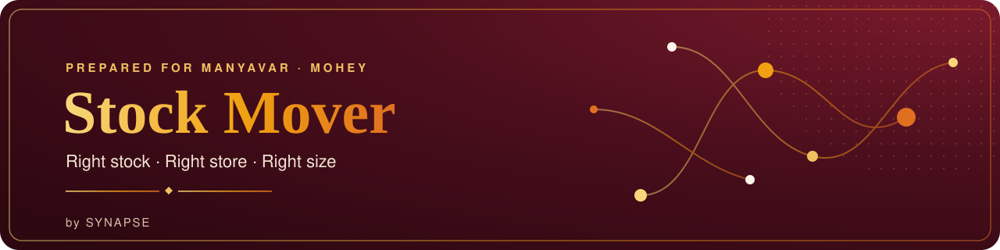

<p align="center">
  
</p>

<p align="center">
  <a href="https://synapse-stock-mover.streamlit.app"></a>
  
  
  
  
</p>

<p align="center">
  <a href="#stock-mover">Stock Mover</a> ·
  <a href="#quick-start">Quick start</a> ·
  <a href="#repository-layout">Layout</a> ·
  <a href="#web-app">Web app</a>
</p>

---

## StockFlow (formerly Stock Mover)

**Right stock, right store, right size, every morning.** StockFlow reads a brand's sales, stock and delivery data and
writes a short list of **trips** to approve: refills before stores run out, broken size sets completed, old stock moved
to where it sells, and slow stock brought back a few pieces at a time. Every trip shows what it earns and what it
costs to move, and moves that don't pay for themselves are left out. Nothing in it is tied to one brand: tiers,
categories, warehouses, freight costs and currency all come from the brand's own sheets and settings.

<table>
  <tr>
    <td width="25%" valign="top"><b>🚚 Trips</b><br>Warehouse refills, store-to-store moves, old stock, capped returns, end-of-season clearance, each with one clubbed reason.</td>
    <td width="25%" valign="top"><b>💰 Money</b><br>Gain vs freight and handling for every move; what doing nothing costs; margin still at risk.</td>
    <td width="25%" valign="top"><b>✅ Approve</b><br>About 25 decisions a day, then transfer orders for any ERP/WMS and receipt tracking.</td>
    <td width="25%" valign="top"><b>📄 Any brand</b><br>A data guide and templates. It needs four sheets to start, and sign-in with roles keeps real data private.</td>
  </tr>
</table>

**Try it:** open the [live app](https://synapse-stock-mover.streamlit.app) and press **Try the demo brand**
(a fictional 9-store brand). If the page asks you to wake it up, click the button and wait about 30 seconds.

| Hackathon pack, plan for 2026-11-01 | Stock Mover | StockFlow |
|---|---|---|
| What to approve | 1,288 lines on 186 routes | **71 trips** (938 lines) |
| Moving cost counted | no | yes: ₹2.3 L, against an estimated ₹69.7 L gain |
| Pulled back in one day | 353 pcs / ₹57 L | 151 pcs / ₹26 L (max ₹1.5 L per store) |
| Rule checks | 11 of 11 | **17 of 17** |

What changed is in [stock_mover/CHANGES.md](stock_mover/CHANGES.md); the data a brand uploads is in
[stock_mover/DATA_GUIDE.md](stock_mover/DATA_GUIDE.md).

## Pitch materials

Everything for the presentation is in [`pitch/`](pitch/):

- **Pitch video:** [`StockFlowAI_pitch.mp4`](pitch/StockFlowAI_pitch.mp4), 2 minutes, with voice-over and captions
- **App tour deck:** [`StockFlowAI_app_tour.pptx`](pitch/StockFlowAI_app_tour.pptx), one slide per tab, plus [speaker notes](pitch/StockFlowAI_app_tour_speaker_notes.docx)
- **Owners' deck:** [`StockFlowAI_owners_deck.pptx`](pitch/StockFlowAI_owners_deck.pptx), with speaker notes in PowerPoint

To check a plan yourself, `python stock_mover/tests/check_plan.py` re-checks it against the raw sheets,
independently of the engine.

## Quick start

```bash
cd stock_mover
python -m pip install -r requirements.txt
python -m streamlit run app.py
```

On Windows you can double-click `stock_mover/Start StockFlow.bat` instead. The full method is in
[stock_mover/README.md](stock_mover/README.md).

## Repository layout

```text
SYNAPSE/
├── stock_mover/          StockFlow app and engine (Python, Streamlit)
│   ├── app.py            the web app
│   ├── engine.py         the planning engine, also runs from the command line
│   ├── schema.py         settings and the sheets a brand uploads
│   ├── brands/           settings profiles (demo brand, hackathon pack)
│   ├── data/demo/        fictional demo brand;  data/csv: hackathon pack
│   ├── sample_output/    a finished demo plan (Excel, CSV, transfer orders)
│   └── tests/check_plan.py  independent check against the raw sheets
├── pitch/                pitch video, decks, speaker notes and the scripts that built them
├── src/                  Synapse website (React, TypeScript, Vite)
└── .github/assets/       logo and banner
```

## Web app

The Synapse website lives at the repo root.

```bash
npm install
npm run dev        # http://localhost:5173
npm run build      # production build in dist/
```

## Brand

Styled for **Manyavar · Mohey**: festive gold drawn from the Manyavar wordmark, deep maroon, ivory backgrounds and
Cormorant Garamond serif headings, with gold ornament dividers.

| Token | Color | Used for |
|---|---|---|
| Deep maroon | `#4a0e1c` | hero backgrounds, headers |
| Maroon | `#8b1a2b` | primary buttons, warehouse sends |
| Gold | `#e8a317` | accents, store-to-store moves |
| Saffron | `#e07020` | aged stock, gradient end |
| Crimson | `#d1495b` | alerts, pull-backs |
| Plum | `#6d3a7d` | display fills |
| Ivory | `#fdf9f3` | page background |

---|---|---|
| Deep | `#4a0e1c` | backgrounds, headers |
| Teal | `#8b1a2b` | primary actions, warehouse sends |
| Gold | `#e8a317` | highlights, store-to-store moves |
| Sand | `#e07020` | aged stock |
| Coral | `#d1495b` | alerts, pull-backs |

---

<p align="center"><sub>Built for the Vedant Fashions (Manyavar) AI Hackathon. Sample data and briefs belong to Vedant Fashions Limited.</sub></p>
